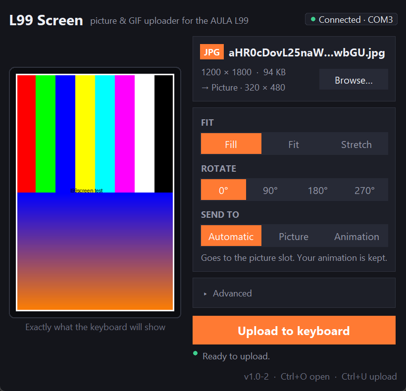

# l99screen

Set the picture or GIF on the **AULA L99** keyboard's 320×480 screen from Linux (also works on Windows).
Unofficial; protocol reverse-engineered from USB captures of AULA's Windows software.



What's new: see [CHANGELOG.md](CHANGELOG.md).

## AppImage (easiest)

Download `L99_Screen-*-x86_64.AppImage` from Releases, then:

```bash
chmod +x L99_Screen-*-x86_64.AppImage
./L99_Screen-*-x86_64.AppImage            # GUI
./L99_Screen-*-x86_64.AppImage gif a.gif  # command line works too
```

**Permissions are handled for you.** Linux doesn't let normal users open the keyboard's serial port
by default. The first time an upload is refused, the app offers to fix it: your system asks for your
password once, the app installs `/etc/udev/rules.d/70-aula-l99-screen.rules`, and the upload continues.
It won't ask again. You can also do it up front with `l99screen setup`, or by hand with
`l99screen udev-rule | sudo tee /etc/udev/rules.d/70-aula-l99-screen.rules`.

## Windows

Download `L99_Screen-*-windows.exe` from Releases and run it. It's a single file with nothing
to install, and it doesn't need AULA's software. The exe isn't code-signed, so SmartScreen may warn
the first time: click **More info → Run anyway**. To build it yourself:
`powershell -ExecutionPolicy Bypass -File packaging\windows\build.ps1`.

## Install from source (Linux)

```bash
pip install --user ".[dnd]"
```

The GUI needs Tk: `sudo apt install python3-tk` (Debian/Ubuntu), `sudo dnf install python3-tkinter`
(Fedora) or `sudo pacman -S tk` (Arch). `.[dnd]` adds drag-and-drop; leave it out and the GUI uses a file picker only.

Connect the keyboard **with the USB cable** (uploads don't work over the 2.4 GHz dongle or Bluetooth).

### GUI

```bash
l99screen-gui
```

Drop a picture or GIF on the preview (or click it to pick one), choose how it fits, then **Upload to keyboard**.
The preview shows exactly what the screen will show, including the GIF timing.

### Command line

```bash
l99screen detect
l99screen image picture.jpg
l99screen gif animation.gif
```

Options: `--fit cover|contain|stretch`, `--rotate 90`, `--preview out.png` (save what will be shown),
`--port /dev/ttyACM0`, and for GIFs `--max-frames N` (default and tested limit 15) and `--delay MS`.

## How it works

The screen is a separate USB serial device in the keyboard (`EEEF:268A`, `/dev/ttyACM*`, 115200 baud).
Frames are `5A A5 | len(3, BE) | cmd | addr(4, BE) | payload | CRC-16/MODBUS (LE)`.
Command `0x64` writes 2 KiB of flash; `0x66` asks for a checksum after every 128 KiB.

| What | Flash address | Format |
|---|---|---|
| Still image | `0x041E0000` | 11-byte header + 320×480 RGB565 little-endian |
| Animation | `0x04240000` | 20-byte entry per frame, then per frame: 16-byte `LT` header, 256-colour RGB565 palette, 320×480 indices |

See `l99screen/protocol.py` and `l99screen/encode.py` for field-level detail.
`tools/test_against_capture.py` checks the encoder against a capture of the official software byte-for-byte.

## Caveats

- The animation is limited to 15 frames by default, the same as the official software. More frames
  would write further into flash, which hasn't been tested and may overwrite other data.
- The `0x66` checksum value returned by the keyboard isn't verified yet (algorithm unknown), but
  each 2 KiB write is acknowledged with `OK`.
- ModemManager can grab new `/dev/ttyACM*` devices. The udev rule tells it to ignore this one.

## License

[MIT](LICENSE). This is an independent project, not affiliated with or endorsed by AULA. "AULA"
and "L99" are used only to name the hardware it works with.
